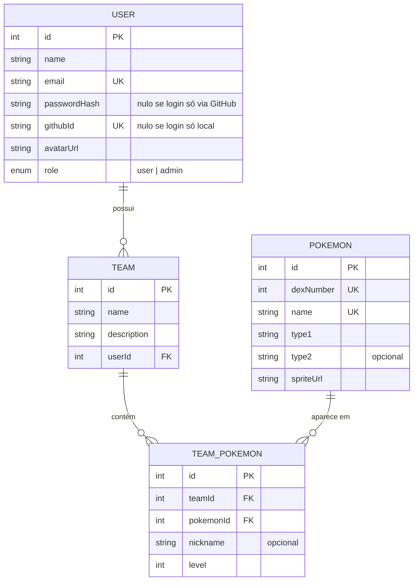

# Planejamento da API - PokéTeams

## 1. Nome provisório

**PokéTeams**: API RESTful para montagem de times Pokémon.

## 2. Problema / necessidade

Jogadores de Pokémon costumam planejar seus times antes de jogar (quais espécies usar, apelidos, níveis), mas fazem isso em anotações soltas ou planilhas. O PokéTeams oferece um lugar centralizado onde cada treinador mantém seus times, consultando um catálogo de espécies padronizado.

## 3. Funcionamento do sistema

1. O treinador se cadastra com nome, e-mail e senha **ou** entra com a conta do **GitHub** (OAuth).
2. Nos dois casos a API emite um **token JWT**, que deve ser enviado no cabeçalho `Authorization: Bearer <token>` nas rotas privadas.
3. O **catálogo de Pokémon** é público: qualquer pessoa pode listar e consultar espécies, com filtro por nome e tipo. O catálogo é populado por um seed com dados da PokéAPI. Apenas usuários **admin** podem criar, editar ou remover espécies.
4. O treinador autenticado cria **times**, e cada time pode ter **no máximo 6 Pokémon**. Ao adicionar um Pokémon ao time ele pode definir um **apelido** e um **nível** (1 a 100). A mesma espécie pode aparecer mais de uma vez no time.
5. Cada time pertence a um único treinador, e **só o dono** pode ver, editar ou excluir seus times.
6. Um front-end simples consome a API para demonstrar o funcionamento.

## 4. Modelo de dados



### Relacionamentos (Sequelize)

| Relação | Tipo | Associação |
|---|---|---|
| User -> Team | 1:N | `User.hasMany(Team)` / `Team.belongsTo(User)` |
| Team <-> Pokemon | N:N (via `TeamPokemon`) | `Team.belongsToMany(Pokemon, { through: TeamPokemon })` / `Pokemon.belongsToMany(Team, { through: TeamPokemon })` |

### Validações principais

| Model | Campo | Regra |
|---|---|---|
| User | name | obrigatório, 2 a 60 caracteres |
| User | email | obrigatório, único, formato de e-mail |
| User | password (entrada) | mínimo 6 caracteres, armazenada como hash bcrypt |
| Team | name | obrigatório, 1 a 40 caracteres |
| Team | description | opcional, até 200 caracteres |
| Pokemon | dexNumber | obrigatório, único, inteiro >= 1 |
| Pokemon | name | obrigatório, único |
| Pokemon | type1 | obrigatório, um dos 18 tipos oficiais |
| TeamPokemon | level | inteiro de 1 a 100 (padrão 5) |
| TeamPokemon | nickname | opcional, até 20 caracteres |
| TeamPokemon | regra de negócio | máximo de 6 Pokémon por time |

## 5. Endpoints previstos

Acesso: **Público**, **Autenticado** (token JWT) ou **Admin** (token JWT de um usuário com papel admin).

### Autenticação

| Método | Rota | Acesso | Parâmetros | Resposta esperada |
|---|---|---|---|---|
| POST | `/auth/register` | Público | body: `name`, `email`, `password` | **201** `{ user, token }`, 400 dados inválidos, 409 e-mail já cadastrado |
| POST | `/auth/login` | Público | body: `email`, `password` | **200** `{ user, token }`, 400 campos faltando, 401 credenciais inválidas |
| GET | `/auth/github` | Público | - | **302** redireciona para a autorização do GitHub, 503 OAuth não configurado |
| GET | `/auth/github/callback` | Público | query: `code`, `state` | **302** redireciona para o front com o JWT (ou **200** `{ user, token }` sem front), 400 `code`/`state` inválido, 502 falha ao falar com o GitHub |
| GET | `/auth/me` | Autenticado | - | **200** dados do usuário logado, 401 |

### Pokémon (catálogo)

| Método | Rota | Acesso | Parâmetros | Resposta esperada |
|---|---|---|---|---|
| GET | `/pokemon` | Público | query: `name`, `type`, `page`, `limit` | **200** `{ data: [...], page, limit, total }` |
| GET | `/pokemon/:id` | Público | path: `id` | **200** espécie, 404 não encontrada |
| POST | `/pokemon` | Admin | body: `dexNumber`, `name`, `type1`, `type2?`, `spriteUrl?` | **201** espécie criada, 400, 401, 403, 409 duplicada |
| PUT | `/pokemon/:id` | Admin | path: `id`, body: campos da espécie | **200** espécie atualizada, 400, 401, 403, 404 |
| DELETE | `/pokemon/:id` | Admin | path: `id` | **204**, 401, 403, 404 |

### Times

| Método | Rota | Acesso | Parâmetros | Resposta esperada |
|---|---|---|---|---|
| GET | `/teams` | Autenticado | - | **200** times do usuário logado |
| POST | `/teams` | Autenticado | body: `name`, `description?` | **201** time criado para o usuário do token, 400, 401 |
| GET | `/teams/:id` | Autenticado | path: `id` | **200** time com seus Pokémon, 401, 403 não é o dono, 404 |
| PUT | `/teams/:id` | Autenticado | path: `id`, body: `name`, `description?` | **200** time atualizado, 400, 401, 403, 404 |
| DELETE | `/teams/:id` | Autenticado | path: `id` | **204**, 401, 403, 404 |

### Pokémon dentro de um time (relacionamento N:N)

| Método | Rota | Acesso | Parâmetros | Resposta esperada |
|---|---|---|---|---|
| POST | `/teams/:id/pokemon` | Autenticado | path: `id`, body: `pokemonId`, `nickname?`, `level?` | **201** entrada criada, 400 time cheio ou nível inválido, 401, 403, 404 |
| PATCH | `/teams/:id/pokemon/:entryId` | Autenticado | path: `id`, `entryId`, body: `nickname?`, `level?` | **200** entrada atualizada, 400, 401, 403, 404 |
| DELETE | `/teams/:id/pokemon/:entryId` | Autenticado | path: `id`, `entryId` | **204**, 401, 403, 404 |

`entryId` é o id da linha em `TeamPokemon`, e não o da espécie. Assim é possível ter a mesma espécie duas vezes no time e editar ou remover cada uma separadamente.

## 6. Recursos que exigem autenticação

| Recurso | Leitura | Escrita |
|---|---|---|
| Autenticação (`/auth/*`) | `/auth/me` exige token, as demais são públicas | - |
| Pokémon (catálogo) | Pública | Apenas admin |
| Times | Apenas o dono | Apenas o dono |
| Pokémon do time | Apenas o dono do time | Apenas o dono do time |

### Comportamento do middleware de autenticação

| Situação | Status | Mensagem |
|---|---|---|
| Cabeçalho `Authorization` ausente | 401 | `Token não fornecido` |
| Token malformado ou assinatura inválida | 401 | `Token inválido` |
| Token expirado | 401 | `Token expirado` |
| Token válido, mas sem permissão | 403 | `Acesso negado` |

### Formato padrão de erro

```json
{
  "error": {
    "status": 400,
    "message": "O time já possui 6 Pokémon",
    "details": []
  }
}
```

`details` lista os erros de validação por campo, quando houver.

## 7. Stack

| Camada | Tecnologia |
|---|---|
| Servidor / rotas | Node.js + Express |
| ORM / banco | Sequelize + SQLite |
| Senhas | bcrypt |
| Token | jsonwebtoken (JWT) |
| OAuth | GitHub, fluxo Authorization Code |
| Disponibilização | Túnel (Cloudflare Tunnel ou ngrok) |
